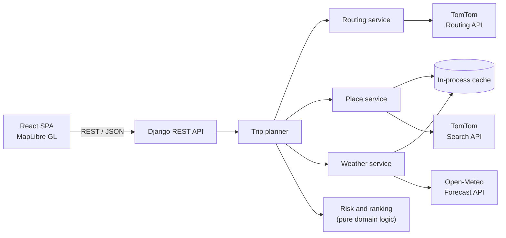
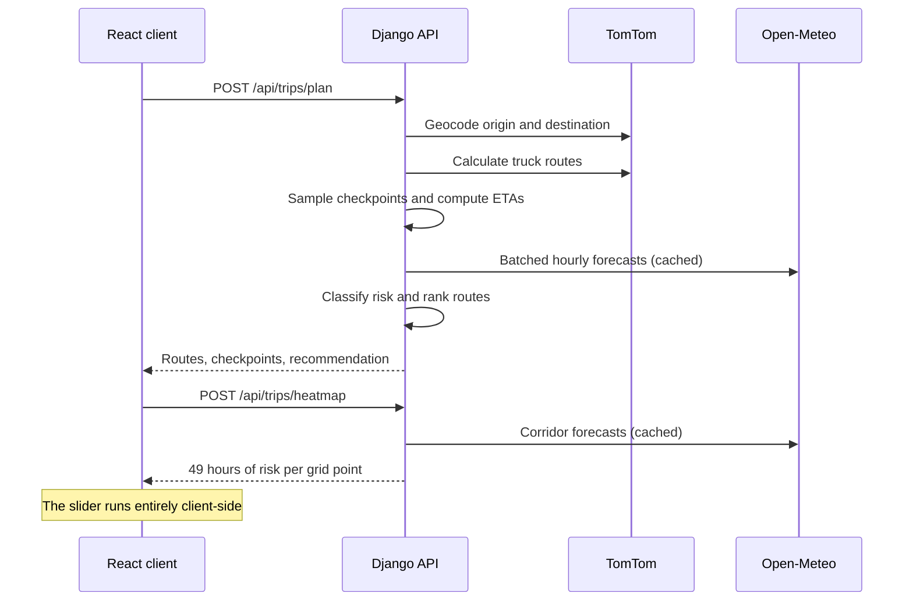

# Weather-Aware Truck Routing

A full-stack decision-support application that helps truck drivers choose the safest route for a trip. Given an origin, destination, departure time and load weight, the system generates three truck routes, evaluates forecast weather at the moment the truck is expected to reach each point on the road, classifies the risk against load-aware safety rules, and recommends a route.

## Contents

- [Capabilities](#capabilities)
- [Architecture](#architecture)
- [Technology](#technology)
- [Domain Rules](#domain-rules)
- [Engineering Decisions](#engineering-decisions)
- [Getting Started](#getting-started)
- [Configuration](#configuration)
- [API Reference](#api-reference)
- [Testing and Quality](#testing-and-quality)
- [Performance](#performance)
- [Security](#security)
- [Deployment](#deployment)
- [Repository Structure](#repository-structure)
- [Known Limitations](#known-limitations)

## Capabilities

| Capability | Description |
|---|---|
| Route generation | Three distinct truck routes per trip, with weight-aware routing and a fallback when the provider returns fewer alternatives |
| Time-aware weather | Forecasts are read for each checkpoint's estimated arrival time rather than the departure time |
| Configurable sampling | Checkpoints every 10, 25 or 50 miles |
| Risk classification | Wind, rain and snow thresholds combined with load-weight rules |
| Recommendation | Deterministic ranking, with an explanation of what beat each alternative |
| Map visualization | All routes colored by risk, checkpoint details and ETAs, and per-route summaries |
| Forecast heatmap | Weather risk along the trip corridor with a 0 to 48 hour slider |

## Architecture



The backend separates pure domain logic from I/O. `risk.py` and `recommend.py` have no external dependencies, so the safety rules can be tested exhaustively without network access. Provider integrations are isolated in their own service modules, and all outbound HTTP passes through a single client that owns timeouts, retries, logging and error translation.

### Request flow



Routes and the heatmap are separate requests so that the primary result renders without waiting for corridor data. The API is stateless: trips are computed per request, and only forecasts and place lookups are cached.

## Technology

| Layer | Technology |
|---|---|
| Backend | Python, Django 5, Django REST Framework |
| Frontend | React 19, TypeScript, Vite |
| Mapping | MapLibre GL, OpenFreeMap tiles |
| Routing and geocoding | TomTom Routing API, TomTom Search API |
| Weather | Open-Meteo Forecast API |
| Testing | pytest, pytest-django, Vitest |
| Static analysis | Ruff, TypeScript strict mode |
| Hosting | Render (API), Vercel (client) |

## Domain Rules

### Risk thresholds

| Condition | Low | Moderate | High | Severe | No Travel |
|---|---|---|---|---|---|
| Wind (mph) | < 25 | 25-34 | 35-44 | 45-54 | 55 or more |
| Rain (in/hr) | < 0.10 | 0.10-0.25 | 0.25-0.50 | 0.50-1.00 | > 1.00 |
| Snow (in/hr) | < 0.5 | 0.5-1.0 | 1.0-2.0 | 2.0-3.0 | > 3.0 |

### Load rules

| Wind | Load | Result |
|---|---|---|
| 55 mph or more | Any | No Travel |
| 45-54 mph | Over 30,000 lb | No Travel |
| 35-44 mph | Over 40,000 lb | Severe |

A checkpoint takes the worst level across wind, rain and snow after load rules are applied.

### Recommendation order

Routes are compared lexicographically:

1. Fewest No Travel miles
2. Fewest miles without forecast coverage
3. Fewest Severe miles
4. Fewest High miles
5. Lowest average risk
6. Shortest travel time

Criteria 3 to 6 are the specified order. Criteria 1 and 2 are added ahead of them so that a route cannot win because its danger falls outside the Severe count. If every route crosses No Travel weather, the system reports that no safe route exists and identifies the least risky option. If the best route extends past the forecast range, the result is flagged as incomplete.

## Engineering Decisions

The specification leaves several behaviors open. Each was resolved deliberately:

| Area | Decision | Rationale |
|---|---|---|
| Shared band edges | A value on a shared edge takes the higher band. Exactly 1.00 in/hr rain and 3.0 in/hr snow remain Severe | Ambiguity resolves toward caution, and No Travel is defined as strictly greater |
| Mileage attribution | Each checkpoint owns the distance halfway to its neighbors | Totals equal the route length and match the colored segments on the map |
| Average risk | Low = 0 through No Travel = 4, weighted by distance | A short final segment should not count as much as a full interval |
| Comparison tolerance | Miles compared to 0.1, average risk to 0.01 | Floating-point noise must not decide a safety ranking |
| Missing forecasts | Reported as "no data" and never counted as Low | Unknown weather must not present as safe weather |
| ETA calculation | Interpolated from the provider's elapsed-time table along the route | Reflects slow urban stretches, which a constant speed would not |
| Truck speed | Capped at 65 mph when routing | The provider otherwise applies posted car speeds, producing ETAs that are too early |
| Load weight | Sent to the router as the vehicle's weight | The input is a single weight value |
| Rain measurement | Open-Meteo `rain` plus `showers` | Convective rainfall is reported separately and would otherwise be missed |
| Forecast timing | Wind is interpolated between hours; rain and snow read from the hour containing the ETA | Wind is instantaneous, while precipitation is a total for the preceding hour |
| Wind measurement | Sustained speed at 10 m | The specified thresholds do not reference gusts |
| Three-route guarantee | Via points offset from the direct line, keeping only routes on different roads | Providers may return fewer alternatives than requested |
| Slider origin | Hours from departure, with the absolute time displayed | The driver's reference point is the moment of leaving |
| Coverage | Any country, with units as specified (miles, mph, lb) | Both providers operate worldwide |

## Getting Started

### Prerequisites

- Python 3.11 or newer
- Node.js 20 or newer
- A TomTom API key, available from [developer.tomtom.com](https://developer.tomtom.com)

Open-Meteo does not require a key.

### Backend

Set `TOMTOM_API_KEY` in your environment, then run:

```bash
cd backend
python -m venv .venv
source .venv/bin/activate       # Windows: .venv\Scripts\Activate.ps1
pip install -r requirements-dev.txt
python manage.py runserver
```

The API is served at `http://localhost:8000`.

### Frontend

```bash
cd frontend
npm ci
npm run dev
```

The client is served at `http://localhost:5173` and proxies `/api` to the backend.

## Configuration

All configuration is supplied through environment variables.

| Variable | Service | Required | Description |
|---|---|---|---|
| `TOMTOM_API_KEY` | Backend | Yes | Authenticates routing, geocoding and place suggestions |
| `DJANGO_SECRET_KEY` | Backend | No | Generated at startup when unset. The application signs no data and stores no sessions |
| `DJANGO_DEBUG` | Backend | No | Defaults to `false` |
| `DJANGO_ALLOWED_HOSTS` | Backend | Production | Comma-separated hostnames serving the API |
| `CORS_ALLOWED_ORIGINS` | Backend | Production | Comma-separated origins of the client |
| `VITE_API_URL` | Frontend | Production | Origin of the API. Unset locally, where Vite proxies requests |

## API Reference

### `POST /api/trips/plan`

Generates routes, assesses weather and returns a recommendation.

| Field | Type | Constraints |
|---|---|---|
| `origin` | string | Required, up to 200 characters |
| `destination` | string | Required, up to 200 characters |
| `departure_at` | ISO 8601 datetime | Not in the past, at most 7 days ahead |
| `load_lb` | integer | 1 to 200,000 |
| `interval_miles` | integer | 10, 25 or 50. Defaults to 25 |

```json
{
  "origin": "Denver, CO",
  "destination": "Chicago, IL",
  "departure_at": "2026-11-12T14:00:00Z",
  "load_lb": 42000,
  "interval_miles": 25
}
```

Response (abbreviated):

```json
{
  "origin": { "name": "Denver, CO", "lat": 39.738453, "lon": -104.984853 },
  "destination": { "name": "Chicago, IL", "lat": 41.875562, "lon": -87.624421 },
  "routes": [
    {
      "id": "A",
      "duration_s": 57960,
      "distance_miles": 1005.3,
      "average_risk": 0.0,
      "miles_by_risk": {
        "low": 1005.3, "moderate": 0.0, "high": 0.0,
        "severe": 0.0, "no_travel": 0.0, "no_data": 0.0
      },
      "segments": [{ "risk": "low", "path": [[39.73845, -104.98485]] }],
      "checkpoints": [
        {
          "mile": 25.0,
          "lat": 39.98868,
          "lon": -104.73322,
          "eta": "2026-11-12T14:28:18Z",
          "risk": "low",
          "weather": { "wind_mph": 6.7, "rain_in_hr": 0.0, "snow_in_hr": 0.0 }
        }
      ]
    }
  ],
  "recommendation": {
    "route_id": "A",
    "is_safe": true,
    "is_complete": true,
    "reason": "This route has a shorter travel time than Route B and C."
  }
}
```

### `POST /api/trips/heatmap`

Returns hourly risk for a grid of points along the trip corridor. Accepts `departure_at`, `load_lb` and `paths`, an array of up to three coordinate lists.

### `GET /api/places?q=`

Returns place suggestions for queries of three or more characters.

### Errors and limits

| Status | Meaning |
|---|---|
| 400 | Invalid input, with a message per field |
| 422 | A place or route could not be found, or the corridor is too large |
| 429 | Request limit exceeded |
| 502 | An upstream routing or weather service failed |

Errors other than field validation return `{"detail": "..."}` with a message suitable for display. Each client address is limited to 30 trip requests and 120 suggestion requests per minute.

## Testing and Quality

```bash
cd backend
pytest
ruff check .
```

```bash
cd frontend
npm test
npm run build
```

The backend suite runs offline with external services replaced by fixed responses. Coverage includes:

- Every band edge in the risk table and each load rule at its exact threshold
- Every tie-break in the ranking, including No Travel and missing-forecast cases
- Checkpoint spacing, ETA interpolation and mileage conservation
- Provider response parsing and the three-route fallback
- Forecast timing, batching and caching
- Upstream failure handling, including that API keys never reach logs
- Request validation, rate limiting and error responses

## Performance

**Heatmap.** The slider performs no network requests. All 49 hours load in a single response over a grid of roughly 300 points, with spacing derived from the trip's size so that rendering cost stays roughly constant regardless of distance.

Each forecast hour is a separate MapLibre layer, and moving the slider changes only which layer is opaque. Updating `heatmap-weight` would be the conventional approach, but it is a data-driven property that forces the source's tiles to rebuild on every change. `heatmap-opacity` is a plain paint property, and layers at zero opacity skip their render pass. Stepping through all 49 hours on every animation frame measured 16.7 to 17.9 ms per frame on a 1,000-mile trip, after a one-time setup cost per layer.

Heatmap intensity is derived from the rendering kernel and grid spacing, so color reflects each cell's risk level rather than how many cells overlap.

**Backend.** Forecasts are requested on a 0.1 degree grid in concurrent batches of 100 locations and cached for one hour, so nearby checkpoints share a lookup. Place lookups are cached for 24 hours. Route geometry is thinned before transfer and responses are gzip-compressed.

## Security

- API keys are held server-side and read from the environment. The client never receives them.
- Outbound failures are logged by status or exception type only, because exception text can contain request URLs with credentials.
- All input is validated at the API boundary, including limits on the size and geographic spread of heatmap requests.
- Public endpoints are rate limited per client to protect provider quotas.
- `DEBUG` is off by default, and CORS and allowed hosts are explicit allowlists.

## Deployment

**API (Render).** `render.yaml` defines the service. Create a Blueprint from this repository and supply `TOMTOM_API_KEY`, `DJANGO_ALLOWED_HOSTS` and `CORS_ALLOWED_ORIGINS`.

**Client (Vercel).** Import this repository with `frontend` as the root directory and set `VITE_API_URL` to the API's origin.

The API runs as a single Gunicorn worker with multiple threads so that all requests share one in-process cache.

## Repository Structure

```
backend/
  config/                  Django settings and URL configuration
  trips/
    api/                   Endpoints, validation, serialization, throttling, error mapping
    services/
      risk.py              Risk and load rules (pure)
      recommend.py         Mileage attribution and ranking (pure)
      checkpoints.py       Checkpoint positions and ETAs
      routing.py           TomTom routing and the three-route fallback
      places.py            TomTom geocoding and suggestions
      weather.py           Open-Meteo client and forecast cache
      heatmap.py           Corridor grid generation
      planner.py           Trip orchestration
      http.py              Shared outbound HTTP client
    tests/                 Test suite
frontend/
  src/
    components/            Trip form, route list, map, heatmap control
    map/                   MapLibre route and heatmap layers
    api.ts                 API client
    types.ts               API response types
render.yaml                Deployment blueprint
```

## Known Limitations

- ETAs reflect drive time only. Rest breaks and regulated driving hours are out of scope and would extend long trips.
- Departures are limited to 7 days ahead so that forecasts cover the trip.
- The cache and rate-limit counters are per process. A horizontally scaled deployment would move both to a shared store such as Redis.
- Times are displayed in the viewer's time zone rather than each checkpoint's local time.
- The free tiers of TomTom and Open-Meteo are intended for evaluation and non-commercial use. Production use requires paid plans.
